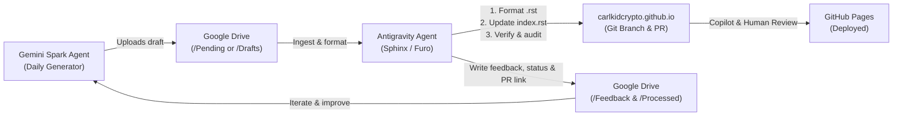

# Gemini Spark Daily Blog Publishing Skill

This skill documents the automated/pair-programming procedure to ingest daily
blog post drafts produced by the **Gemini Spark Agent** in Google Drive, transform
them into publication-ready Sphinx articles for [carlkidcrypto.github.io](https://carlkidcrypto.github.io),
validate code snippets and theme compliance, open a GitHub Pull Request, and
communicate review status and feedback back to the Gemini Spark Agent via Google Drive.

---

## Architecture Overview



---

## Step 1: Discover Pending Posts in Google Drive

When Google Drive for Desktop is installed on macOS, it synchronizes cloud folders
locally under one of the standard mount paths:

1. **Standard macOS CloudStorage path**:
   ```bash
   ~/Library/CloudStorage/GoogleDrive-<email>/My Drive/
   ```
2. **Alternative volumes path**:
   ```bash
   /Volumes/GoogleDrive/My Drive/
   ```
3. **Environment Override**:
   Set `GOOGLE_DRIVE_BLOG_DIR` to point directly to the blog sync directory.

### Directory Convention on Google Drive

The Gemini Spark Agent uses the following folder layout:
```text
Google Drive/Blog/
├── Pending/     # Gemini Spark Agent deposits new unreviewed drafts here (.md / .rst / .txt / Docs)
├── Processed/   # Moved here once a PR is opened or post is merged
└── Feedback/    # Status logs, PR links, and review notes returned to Gemini Spark Agent
```

To list or inspect pending drafts, run the included helper:
```bash
python3 .agents/skills/gemini-spark-blog/scripts/sync_drive_post.py --list
```
Or check the local mount directly using shell commands.

---

## Step 2: Format for Sphinx & Furo Theme

Convert the draft into a Sphinx reStructuredText file located at:
`source/blog/<slug>.rst`

### Mandatory Post Structure

Every blog post must follow this exact format:

```rst
.. meta::
   :description: <1-2 sentence search engine summary>
   :keywords: <comma-separated keywords, e.g. Python, SNMP, ezsnmp, DevOps, carlkidcrypto>
   :author: Carlos Santos (@carlkidcrypto)
   :property=og:title: <Article Title>
   :property=og:description: <1-2 sentence search engine summary>
   :property=og:type: article
   :property=og:url: https://carlkidcrypto.github.io/blog/<slug>.html
   :property=og:image: https://carlkidcrypto.github.io/_static/logo.png
   :name=twitter:card: summary
   :name=twitter:title: <Article Title>
   :name=twitter:description: <1-2 sentence search engine summary>
   :name=twitter:image: https://carlkidcrypto.github.io/_static/logo.png

==============================================================
<Article Title with Matching Overline and Underline>
==============================================================

.. note::

   * **Published:** <Month Day, Year> (or 'Pending' if awaiting merge)
   * **Authors:** Written by Gemini 3.8 Flash, Co-Authored & Reviewed by `Carlos Santos (@carlkidcrypto) <https://github.com/carlkidcrypto>`_
   * **Estimated Reading Time:** <N> minutes
   * **Tags:** `Tag1` • `Tag2` • `Tag3`

<Opening Section Title>
=======================

<Introduction paragraph...>
```

### Critical Formatting Rules

> [!CAUTION]
> **Zero `.. contents::` Directives**: Never insert an in-page `.. contents::` directive.
> The **Furo** theme automatically generates the in-page table of contents in the right sidebar.
> An in-page `.. contents::` triggers a red theme warning banner in Furo and will fail the repository audit.

* **Section Underlines**: Use standard Docutils adornments in order:
  - Title: Overline and underline with `=`
  - H1 sections: `=`
  - H2 subsections: `-`
  - H3 sub-subsections: `~`
* **Code Blocks**: Specify language explicitly (e.g., `.. code-block:: python`, `.. code-block:: bash`).
* **Cross-References**: Always use full external HTTPS URLs or Sphinx `:doc:` / `:ref:` directives.

See [references/blog_format_guide.md](./references/blog_format_guide.md) for full style guidelines.

---

## Step 3: Register Article in `source/blog/index.rst`

Every new post must be registered in two locations within `source/blog/index.rst`:

1. **In the `.. toctree::` directive**:
   ```rst
   .. toctree::
      :maxdepth: 1
      :caption: Articles:

      <new-slug>
      ezsnmp-high-throughput-multithreading
      ezsnmp-snmpv3-deep-dive
      ezsnmp-getting-started-guide
   ```
2. **In the `All Posts` card grid (`.. grid-item-card::`)**:
   ```rst
   .. grid-item-card:: <Relevant Emoji> <Article Title>
      :link: <new-slug>
      :link-type: doc

      <2-3 sentence teaser summary of what the reader will learn.>

      +++
      📅 *<Month Day, Year>* • ⏱️ *<N> min read* • `<Tag1>` `<Tag2>` `<Tag3>`
   ```

---

## Step 4: Verification & Audit

Before committing, run all verification checks locally:

```bash
# 1. Audit structural standards and Furo theme rules
python3 .github/scripts/audit_blog_posts.py

# 2. Build Sphinx site with warnings treated as errors
.venv/bin/sphinx-build -b html source _build/html -W

# 3. Verify code snippets (if applicable)
# Test Python snippets against real modules (e.g. ezsnmp, purpleair_api)
```

Common pitfalls to check:
- Never use hallucinated attributes (e.g. `ezsnmp.version` does not exist; use `from importlib.metadata import version; version('ezsnmp')`).
- Highlight real multi-processing models when discussing Net-SNMP rather than unbounded threads.
- Ensure all Sphinx target links resolve cleanly without broken references.

---

## Step 5: Git Branch & Pull Request

1. Create a clean branch from `main`:
   ```bash
   git checkout main && git pull origin main
   git checkout -b feature/blog-<slug>
   ```
2. Stage and commit changes:
   ```bash
   git add source/blog/<slug>.rst source/blog/index.rst
   git commit -m "feat(blog): add <topic> blog post" -m "Co-authored-by: Gemini 3.8 Flash <gemini@google.com>"
   ```
3. Push branch and create PR using GitHub CLI:
   ```bash
   git push -u origin feature/blog-<slug>
   gh pr create \
     --title "feat(blog): add <topic> blog post" \
     --body "## Summary
   - Adds technical blog post: '<Article Title>' (\`source/blog/<slug>.rst\`).
   - Updates \`source/blog/index.rst\` with toctree registration and responsive grid card.
   - Passed \`audit_blog_posts.py\` and \`sphinx-build -W\` with zero warnings.
   
   Co-authored-by: Gemini 3.8 Flash <gemini@google.com>"
   ```

---

## Step 6: Communicate Back to Gemini Spark Agent via Google Drive

To close the loop with the Gemini Spark Agent:

1. **Move/Archive the Draft**:
   Move the original file from `Blog/Pending/<draft-filename>` to `Blog/Processed/<draft-filename>`.
2. **Write Status & Review Feedback**:
   Create a feedback document in `Blog/Feedback/<slug>-feedback.md` containing:
   - **Status**: `PR_CREATED` or `MERGED`
   - **PR Link**: `https://github.com/carlkidcrypto/carlkidcrypto.github.io/pull/<PR_ID>`
   - **Published Date**: The date stamped or planned
   - **Edits Applied**: Any corrections made during ingest (e.g., Furo TOC fixes, metadata additions, code snippet fixes)
   - **Review Findings**: Any feedback from Copilot or human reviews on GitHub for the Gemini Spark Agent to incorporate into future drafts.

See [references/google_drive_protocol.md](./references/google_drive_protocol.md) for the exact feedback schema and folder conventions.
