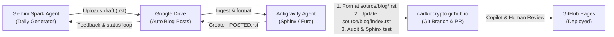

# Gemini Spark Daily Blog Publishing Skill

This skill documents the automated/pair-programming procedure to ingest daily
blog post drafts produced by the **Gemini Spark Agent** in Google Drive (`Auto Blog Posts`),
transform them into publication-ready Sphinx articles for [carlkidcrypto.github.io](https://carlkidcrypto.github.io),
validate code snippets and theme compliance, open a GitHub Pull Request, and
communicate review status and feedback back to the Gemini Spark Agent via Google Drive.

---

## Architecture Overview



---

## Step 1: Discover Pending Posts in Google Drive

Google Drive for Desktop synchronizes cloud folders locally under:
```bash
~/Library/CloudStorage/GoogleDrive-<email>/My Drive/Auto Blog Posts/
```
Or set `GOOGLE_DRIVE_BLOG_DIR` to point to a custom path.

### Folder Layout on Google Drive
```text
Auto Blog Posts/
├── ezsnmp Blog Topic Tracker.gdoc                 # Master topic tracker & agenda
├── ezsnmp_getting_started_guide.rst               # Ingested draft
├── ezsnmp_getting_started_guide - POSTED.rst      # Feedback marker created on PR
├── ezsnmp_working_with_mibs_guide.rst             # PENDING (unprocessed)
└── ...
```

To list all pending and posted drafts, run the included helper script:
```bash
python3 .agents/skills/gemini-spark-blog/scripts/sync_drive_post.py --list
```

---

## Step 2: Ingest & Format for Sphinx / Furo Theme

Run the ingestion tool to automatically convert the draft into Sphinx reStructuredText format and register it in the blog index:

```bash
python3 .agents/skills/gemini-spark-blog/scripts/sync_drive_post.py --ingest <draft_filename_or_slug>
```

This transforms `Auto Blog Posts/ezsnmp_<topic>.rst` into:
`source/blog/ezsnmp-<topic>.rst`

### Mandatory Post Structure

Every blog post must follow this exact format:

```rst
.. meta::
   :description: <1-2 sentence search engine summary>
   :keywords: <comma-separated keywords, e.g. Python, SNMP, ezsnmp, DevOps, carlkidcrypto>
   :author: Carlos Santos (@carlkidcrypto)
   :property=og:title: <Article Title>
   :property=og:description: <1-2 sentence search engine summary>
   :property=og:type: article
   :property=og:url: https://carlkidcrypto.github.io/blog/<slug>.html
   :property=og:image: https://carlkidcrypto.github.io/_static/logo.png
   :name=twitter:card: summary
   :name=twitter:title: <Article Title>
   :name=twitter:description: <1-2 sentence search engine summary>
   :name=twitter:image: https://carlkidcrypto.github.io/_static/logo.png

==============================================================
<Article Title with Matching Overline and Underline>
==============================================================

.. note::

   * **Published:** <Month Day, Year>
   * **Authors:** Written by Gemini 3.8 Flash, Co-Authored & Reviewed by `Carlos Santos (@carlkidcrypto) <https://github.com/carlkidcrypto>`_
   * **Estimated Reading Time:** <N> minutes
   * **Tags:** `Tag1` • `Tag2` • `Tag3`

<Opening Section Title>
=======================

<Introduction paragraph...>
```

### Critical Formatting Rules

> [!CAUTION]
> **Zero `.. contents::` Directives**: Never insert an in-page `.. contents::` directive.
> The **Furo** theme automatically generates the in-page table of contents in the right sidebar.
> An in-page `.. contents::` triggers a red theme warning banner in Furo and will fail the repository audit.

* **Section Underlines**: Use standard Docutils adornments in order:
  - Title: Overline and underline with `=`
  - H1 sections: `=`
  - H2 subsections: `-`
  - H3 sub-subsections: `~`
* **Code Blocks**: Specify language explicitly (e.g., `.. code-block:: python`, `.. code-block:: bash`).
* **Cross-References**: Always use full external HTTPS URLs or Sphinx `:doc:` / `:ref:` directives.

See [references/blog_format_guide.md](./references/blog_format_guide.md) for full style guidelines.

---

## Step 3: Verify Registration in `source/blog/index.rst`

The helper script registers the new post in `source/blog/index.rst`:

1. **In the `.. toctree::` directive**:
   ```rst
   .. toctree::
      :maxdepth: 1
      :caption: Articles:

      <new-slug>
      ezsnmp-high-throughput-multithreading
      ezsnmp-snmpv3-deep-dive
      ezsnmp-getting-started-guide
   ```
2. **In the `All Posts` card grid (`.. grid-item-card::`)**:
   ```rst
   .. grid-item-card:: 📖 <Article Title>
      :link: <new-slug>
      :link-type: doc

      <2-3 sentence teaser summary of what the reader will learn.>

      +++
      📅 *<Month Day, Year>* • ⏱️ *<N> min read* • `<Tag1>` `<Tag2>` `<Tag3>`
   ```

---

## Step 4: Verification, Code Testing & Audit

Before committing or opening a pull request, run all verification and test suites locally:

```bash
# 1. Test and validate all example code snippets in the blog post(s)
# Validates Python syntax, ezsnmp API compliance, bash/YAML syntax, and executes mock test harness
python3 .agents/skills/gemini-spark-blog/scripts/validate_blog_code.py --post <slug>

# Or validate all posts across the repository:
python3 .agents/skills/gemini-spark-blog/scripts/validate_blog_code.py

# 2. Audit structural standards and Furo theme rules
python3 .github/scripts/audit_blog_posts.py

# 3. Build Sphinx site with warnings treated as errors
.venv/bin/sphinx-build -b html source _build/html -W
```

### Code Testing & API Validation Standards

All code blocks in published articles must pass rigorous automated validation:
* **Python Syntax & Compilation**: Parsed with `ast.parse` and compiled with `compile(mode='exec')`.
* **Modern ezsnmp API Standards**:
  - **No Legacy Imports**: Reject `import easysnmp`. Must use `ezsnmp`.
  - **Exception Hierarchy**: Use modern `ezsnmp.exceptions` classes (`GenericError`, `TimeoutError`, `ConnectionError`, `NoSuchInstanceError`). Never use legacy `EasySNMP*` names.
  - **Standardized Method Names**: Use snake_case `session.bulk_walk()` and `session.bulk_get()` (never `.bulkwalk()` or `.get_bulk()`).
  - **Result Attributes**: In ezsnmp Result objects, use `.index` and `.type` (never legacy `.oid_index` or `.snmp_type`).
* **Runtime Test Execution**:
  - `validate_blog_code.py` mounts a sandbox test harness with simulated mock MIB responses (`sysDescr`, `ifDescr`, `ifHCInOctets`, `pethMainPsePower`, `dot1qPvid`, `bgpPeerState`, etc.).
  - Asserts complete runtime execution without `NameError`, `TypeError`, `AttributeError`, `KeyError`, or unhandled exceptions.
* **Auto-Correction**:
  - Run `python3 .agents/skills/gemini-spark-blog/scripts/validate_blog_code.py --fix` to automatically upgrade legacy API patterns in draft posts.

---

## Step 5: Git Branch & Pull Request

1. Create a clean branch from `main`:
   ```bash
   git checkout main && git pull origin main
   git checkout -b feature/blog-<slug>
   ```
2. Stage and commit changes:
   ```bash
   git add source/blog/<slug>.rst source/blog/index.rst
   git commit -m "feat(blog): add <topic> blog post" -m "Co-authored-by: Gemini 3.8 Flash <gemini@google.com>"
   ```
3. Push branch and create PR using GitHub CLI:
   ```bash
   git push -u origin feature/blog-<slug>
   gh pr create \
     --title "feat(blog): add <topic> blog post" \
     --body "## Summary
   - Adds technical blog post: '<Article Title>' (\`source/blog/<slug>.rst\`).
   - Updates \`source/blog/index.rst\` with toctree registration and responsive grid card.
   - Passed \`audit_blog_posts.py\` and \`sphinx-build -W\` with zero warnings.

   Co-authored-by: Gemini 3.8 Flash <gemini@google.com>"
   ```

---

## Step 6: Communicate Back to Gemini Spark Agent via Google Drive

Once the PR is created, create the `<draft_stem> - POSTED.rst` marker in Google Drive to close the feedback loop:

```bash
python3 .agents/skills/gemini-spark-blog/scripts/sync_drive_post.py \
  --mark-posted <draft_filename> \
  --pr https://github.com/carlkidcrypto/carlkidcrypto.github.io/pull/<PR_ID> \
  --review-status "All code snippets 100% verified against local daemon"
```

This creates `Auto Blog Posts/<draft_stem> - POSTED.rst`:
```rst
================================================================================
<draft_stem> - POSTED
================================================================================

This blog post has been audited, verified, and submitted for publication.

Review & Pull Request
---------------------
* PR: https://github.com/carlkidcrypto/carlkidcrypto.github.io/pull/<PR_ID>
* Review Status: All code snippets 100% verified against local daemon
* CI Status: Audit passed (0 errors) & Sphinx build passing (0 warnings)

Publication Target
------------------
* Published Date: October 14, 2026
* Site URL: https://carlkidcrypto.github.io/blog/<slug>.html
* Repository Path: source/blog/<slug>.rst
* Merge Date Automation: Automated via .github/scripts/stamp_blog_dates.py on merge to main
```

See [references/google_drive_protocol.md](./references/google_drive_protocol.md) for full protocol specifications.
