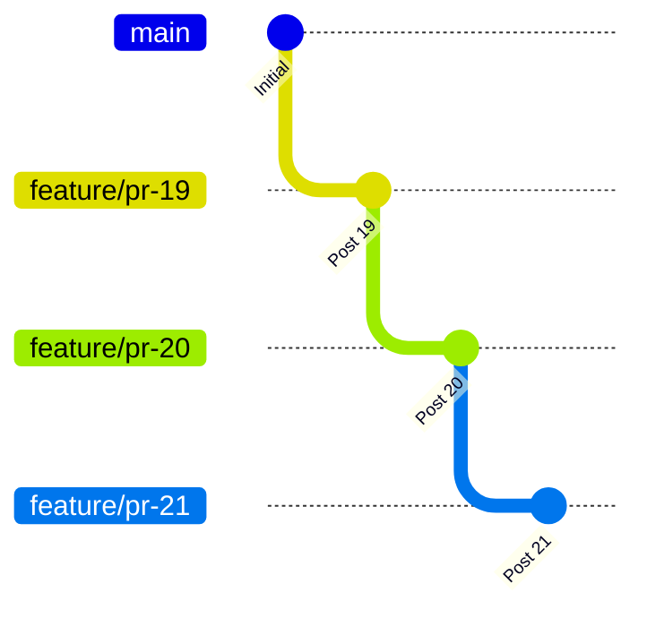

# Stacked Pull Request Merging & Rebasing Guide

This guide establishes the standard operating procedure for managing, merging, and rebasing stacked pull requests in `carlkidcrypto.github.io`.

---

## 1. The Anatomy of Stacked PR Conflicts

When publishing daily technical blog posts or large serial features, branches are stacked sequentially:



When **PR #19** is merged into `main` using GitHub's **Squash and Merge** (or **Rebase and Merge**):
1. GitHub generates a brand new commit on `main` (e.g. `15eb275`).
2. GitHub updates PR #20's target base branch to `main`.
3. **The Conflict**: PR #20's branch still contains the *pre-merge* commit objects of PR #19 (`5590c7c`, etc.). When Git compares PR #20 against `main`, it sees conflicting changes between the individual un-squashed commits and the squashed commit on `main`.

A simple `git rebase main` fails because Git attempts to replay PR #19's commits onto `main` where those exact changes already exist under a different SHA.

---

## 2. The Solution: `git rebase --onto`

The solution is `git rebase --onto`, which transplants only the commits unique to a branch:

### Formula for New Root Branch ($N+1$ onto `main`)
```bash
git checkout <branch_N+1>
git rebase --onto main <old_branch_N_head> <branch_N+1>
```
*Meaning*: Take only the commits in `branch_N+1` that come *after* `old_branch_N_head`, and apply them on top of `main`.

### Formula for Subsequent Stacked Branches ($N+2 \dots K$)
```bash
git checkout <branch_child>
git rebase --onto <parent_branch> <old_parent_sha> <branch_child>
```
*Meaning*: Take only the commits unique to `branch_child` (after `old_parent_sha`), and apply them on top of the newly rebased `parent_branch`.

---

## 3. Automated Stack Rebasing Tool

A dedicated script automates this process end-to-end:
```bash
# Preview the rebase plan:
python3 .agents/skills/gemini-spark-blog/scripts/rebase_stack.py --dry-run

# Execute rebase and force-push all branches:
python3 .agents/skills/gemini-spark-blog/scripts/rebase_stack.py --push
```

### What `rebase_stack.py` Does:
1. **Verifies Clean State**: Confirms the working directory has no uncommitted changes.
2. **Identifies Merged PRs**: Queries GitHub API (`gh pr view`) to see which upstream branches have been merged into `main`.
3. **Fast-Forwards `main`**: Updates local `main` to `origin/main`.
4. **Rebases Root PR**: Runs `git rebase --onto main <old_merged_head> <root_branch>` and updates GitHub PR target base to `main` via `gh pr edit <PR> --base main`.
5. **Cascades Down the Stack**: Sequentially rebases each downstream branch onto its rebased parent using the parent's pre-rebase SHA as the upstream limit.
6. **Pushes with Lease**: Pushes all updated branches using `git push --force-with-lease origin <branch>`.
7. **Triggers Passing CI**: Automatically triggers scoped Sphinx CI checks across all updated PRs.

---

## 4. Standard Workflow for Future Merges

Whenever a pull request in the stack is merged:

```bash
# Step 1: Ensure you are on a clean working tree
git status

# Step 2: Run the automated rebase tool
python3 .agents/skills/gemini-spark-blog/scripts/rebase_stack.py --push

# Step 3: Monitor CI on the new root PR
gh pr checks <next_pr_number>
```

All downstream PRs will immediately show 0 conflicts, with all checks green and ready for the next sequential merge!
